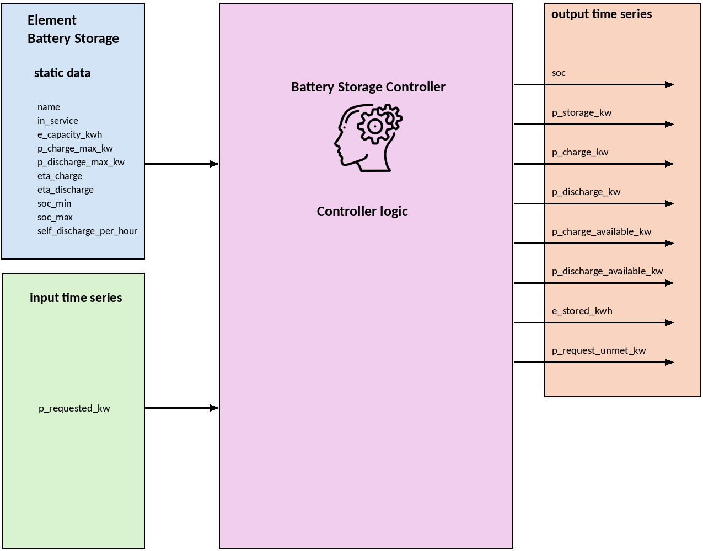

.. _battery_storage_element:

==================
Battery Storage
==================

.. seealso::
    :ref:`Unit Systems and Conventions <conventions>`

.. note::
    A Battery Storage unit consists of an element and a controller.
    The element defines its static / physical parameters,
    while the controller governs the operational logic: it receives a
    requested power, limits it to what the battery can actually deliver or
    absorb, and updates the state of charge (SOC).

    The ``create_controlled_battery_storage`` function creates both and
    connects them.

Create Controlled Function
===========================

.. autofunction:: pandaprosumer.create_controlled_battery_storage

The element alone (without a controller) can be created with:

.. autofunction:: pandaprosumer.create_battery_storage

.. note::
    The parameter checks listed below are performed by the controller.
    An element created only with ``create_battery_storage`` is not validated.

Controller
========================

    ..

.. raw:: html

    

Input Static Data
-------------------

.. csv-table::
    :header: "Parameter", "Description", "Unit"

    "name", "Custom name for the battery storage", "N/A"
    "in_service", "Indicates if the battery storage is in service", "N/A"
    "e_capacity_kwh", "Battery energy capacity", "kWh"
    "p_charge_max_kw", "Maximum charging power (electrical power drawn from the connected system)", "kW"
    "p_discharge_max_kw", "Maximum discharging power (electrical power delivered to the connected system)", "kW"
    "eta_charge", "Charging efficiency, in the range (0, 1]", "-"
    "eta_discharge", "Discharging efficiency, in the range (0, 1]", "-"
    "soc_min", "Minimum allowed state of charge", "-"
    "soc_max", "Maximum allowed state of charge", "-"
    "self_discharge_per_hour", "Fraction of the stored energy lost per hour", "1/h"

Default values of ``create_controlled_battery_storage``:
``eta_charge = 0.95``, ``eta_discharge = 0.95``, ``soc_min = 0.1``,
``soc_max = 0.9``, ``self_discharge_per_hour = 0.0``.

The following conditions are checked when the controller is created, and a
``ValueError`` is raised if one of them is violated:

- ``e_capacity_kwh > 0``
- ``p_charge_max_kw >= 0`` and ``p_discharge_max_kw >= 0``
- ``0 < eta_charge <= 1`` and ``0 < eta_discharge <= 1``
- ``0 <= soc_min < soc_max <= 1``
- ``soc_min <= init_soc <= soc_max``
- ``self_discharge_per_hour >= 0``

.. note::
    The SOC is expressed as a fraction between 0 and 1, not in percent.

Controller Parameters
-----------------------

The following parameters are set in ``create_controlled_battery_storage``
and are not part of the element table.

.. csv-table::
    :header: "Parameter", "Description", "Unit"

    "init_soc", "Initial state of charge (default 0.5). Must lie within [soc_min, soc_max]", "-"
    "period", "Index of the simulation period (default 0)", "N/A"
    "level", "Level of the controller in the control order (default 0)", "N/A"
    "order", "Order of the controller within its level (default 0)", "N/A"

Input Time Series
--------------------

.. csv-table::
    :header: "Parameter", "Description", "Unit"

    "p_requested_kw", "Requested signed battery power (positive: discharge, negative: charge)", "kW"

If the mapped input is empty or ``NaN``, the requested power is set to 0.

Output Time Series
---------------------

.. csv-table::
    :header: "Parameter", "Description", "Unit"

    "soc", "State of charge after the time step", "-"
    "p_storage_kw", "Actual signed battery power (positive: discharge, negative: charge)", "kW"
    "p_charge_kw", "Actual charging power", "kW"
    "p_discharge_kw", "Actual discharging power", "kW"
    "p_charge_available_kw", "Maximum feasible charging power in this time step", "kW"
    "p_discharge_available_kw", "Maximum feasible discharging power in this time step", "kW"
    "e_stored_kwh", "Stored energy after the time step", "kWh"
    "p_request_unmet_kw", "Difference between requested and actual battery power", "kW"

Mapping
----------

The battery storage model can be mapped using :ref:`GenericMapping <GenericMapping>`.

- The battery storage can be used as responder: the requested power is
  taken from the initiator column and mapped to the input ``p_requested_kw``.
- The battery storage can also be used as initiator: any of its output
  columns (e.g. ``soc`` or ``p_storage_kw``) can be mapped to the input of
  another controller.
- The battery storage is an electrical element and does not exchange a fluid
  mixture, so :ref:`FluidMixMapping <FluidMixMapping>` is not applicable.

Typical usage: a controller that computes the dispatch (e.g. the electrical
optimization controller, see :doc:`opf_integration`) is the initiator, and the
battery storage is the responder, with ``p_requested_kw`` as responder column.

.. note::
    If nothing is mapped to ``p_requested_kw``, the requested power is 0 and
    the battery storage stays idle (apart from the self-discharge).

.. code-block:: python

    from pandaprosumer.create_controlled import create_controlled_battery_storage
    from pandaprosumer.mapping import GenericMapping

    # ``prosumer`` is an existing prosumer container and ``optimization_index``
    # is the index of the controller that computes the dispatch.
    battery_index = create_controlled_battery_storage(
        prosumer=prosumer,
        e_capacity_kwh=1000,
        p_charge_max_kw=500,
        p_discharge_max_kw=500,
        eta_charge=0.95,
        eta_discharge=0.95,
        soc_min=0.10,
        soc_max=0.90,
        self_discharge_per_hour=0.0001,
        init_soc=0.60,
        name="Battery",
        level=2,
        order=0,
    )

    GenericMapping(
        prosumer,
        initiator_id=optimization_index,
        initiator_column="p_battery_kw",
        responder_id=battery_controller_index,
        responder_column="p_requested_kw",
    )

Model
=================

.. autoclass:: pandaprosumer.controller.models.BatteryStorageController
    :members:

Sign convention
-----------------

- :math:`P_\text{req} > 0`: the battery is discharged
- :math:`P_\text{req} < 0`: the battery is charged

All powers are electrical powers at the connection point of the battery.
The efficiencies :math:`\eta_\text{ch}` and :math:`\eta_\text{dis}` only
affect the relation between these powers and the stored energy.

Available power
-----------------

At the beginning of each time step of length :math:`\Delta t` (in hours),
the SOC is first reduced by the self-discharge and limited to the SOC range:

.. math::
    :nowrap:

    \begin{align*}
        \text{SOC}_\text{loss} &= \text{clip}\left(\text{SOC}_t \cdot \max\left(0,\; 1 - k_\text{sd}\,\Delta t\right),\; \text{SOC}_\text{min},\; \text{SOC}_\text{max}\right)
    \end{align*}

The feasible charging and discharging power results from the power limits
and from the energy that can still be stored or taken from the battery:

.. math::
    :nowrap:

    \begin{align*}
        P_\text{ch,avail} &= \max\left(0,\; \min\left(P_\text{ch,max},\; \frac{(\text{SOC}_\text{max} - \text{SOC}_\text{loss})\, E_\text{cap}}{\eta_\text{ch}\, \Delta t}\right)\right) \\
        P_\text{dis,avail} &= \max\left(0,\; \min\left(P_\text{dis,max},\; \frac{\eta_\text{dis}\, (\text{SOC}_\text{loss} - \text{SOC}_\text{min})\, E_\text{cap}}{\Delta t}\right)\right)
    \end{align*}

Applied power
-----------------

The requested power is limited to the feasible range:

.. math::
    :nowrap:

    \begin{align*}
        P_\text{storage} &= \text{clip}\left(P_\text{req},\; -P_\text{ch,avail},\; P_\text{dis,avail}\right) \\
        P_\text{ch} &= \max(-P_\text{storage},\; 0) \\
        P_\text{dis} &= \max(P_\text{storage},\; 0) \\
        P_\text{unmet} &= P_\text{req} - P_\text{storage}
    \end{align*}

State of charge update
------------------------

.. math::
    :nowrap:

    \begin{align*}
        E_{t+1} &= E_t \cdot \max\left(0,\; 1 - k_\text{sd}\,\Delta t\right) + \eta_\text{ch}\, P_\text{ch}\, \Delta t - \frac{P_\text{dis}\, \Delta t}{\eta_\text{dis}} \\
        \text{SOC}_{t+1} &= \text{clip}\left(\frac{E_{t+1}}{E_\text{cap}},\; \text{SOC}_\text{min},\; \text{SOC}_\text{max}\right)
    \end{align*}

Where:

- :math:`E_t = \text{SOC}_t \cdot E_\text{cap}` is the stored energy at the beginning of the time step
- :math:`E_\text{cap}` is the energy capacity (``e_capacity_kwh``)
- :math:`P_\text{req}` is the requested power (``p_requested_kw``)
- :math:`P_\text{ch,max}`, :math:`P_\text{dis,max}` are ``p_charge_max_kw`` and ``p_discharge_max_kw``
- :math:`\eta_\text{ch}`, :math:`\eta_\text{dis}` are ``eta_charge`` and ``eta_discharge``
- :math:`\text{SOC}_\text{min}`, :math:`\text{SOC}_\text{max}` are ``soc_min`` and ``soc_max``
- :math:`k_\text{sd}` is ``self_discharge_per_hour``
- :math:`\Delta t` is the time step length in hours (the resolution in seconds divided by 3600)

.. note::
    The self-discharge is modelled as a linear loss per time step, not as an
    exponential decay. The final clipping keeps the SOC within
    :math:`[\text{SOC}_\text{min}, \text{SOC}_\text{max}]`, so self-discharge
    never reduces the SOC below ``soc_min``.

Worked example
-----------------

One time step of a battery with :math:`E_\text{cap} = 1000` kWh,
:math:`P_\text{ch,max} = P_\text{dis,max} = 500` kW,
:math:`\eta_\text{ch} = \eta_\text{dis} = 0.95`,
:math:`\text{SOC}_\text{min} = 0.1`, :math:`\text{SOC}_\text{max} = 0.9`,
:math:`k_\text{sd} = 0` and :math:`\Delta t = 0.25` h (15 minutes).

.. csv-table::
    :header: "Quantity", "Case A: discharge request", "Case B: charge request"

    ":math:`\text{SOC}_t`", "0.60", "0.85"
    ":math:`P_\text{req}`", "+700 kW", "-700 kW"
    ":math:`P_\text{ch,avail}`", "500 kW", "210.53 kW"
    ":math:`P_\text{dis,avail}`", "500 kW", "500 kW"
    ":math:`P_\text{storage}`", "+500 kW", "-210.53 kW"
    ":math:`P_\text{unmet}`", "200 kW", "-489.47 kW"
    ":math:`E_{t+1}`", "468.42 kWh", "900.00 kWh"
    ":math:`\text{SOC}_{t+1}`", "0.4684", "0.90"

In case A the request exceeds the power limit :math:`P_\text{dis,max}`, so only
500 kW are delivered and 200 kW remain unmet. In case B the power limit is not
the constraint: the battery can only absorb the energy up to
:math:`\text{SOC}_\text{max}`, which is
:math:`(0.9 - 0.85) \cdot 1000 / (0.95 \cdot 0.25) = 210.53` kW for this time step.

Out of service
-----------------

If the battery element or the controller is out of service, all powers
(including the available powers) are set to zero for that time step and the
SOC remains unchanged.

Assumptions and Limitations
-----------------------------

- One battery storage controller manages exactly one battery storage element.
- The efficiencies, the power limits and the capacity are constants of the
  element. The model does not depend on the SOC, the temperature or the
  power level.
- No ageing or capacity fade, no ramp-rate limits and no reactive power are
  modelled. The battery storage only exchanges active power.
- The time step length :math:`\Delta t` is taken from the resolution of the
  simulation period.
- ``init_soc`` is only checked when the controller is created.